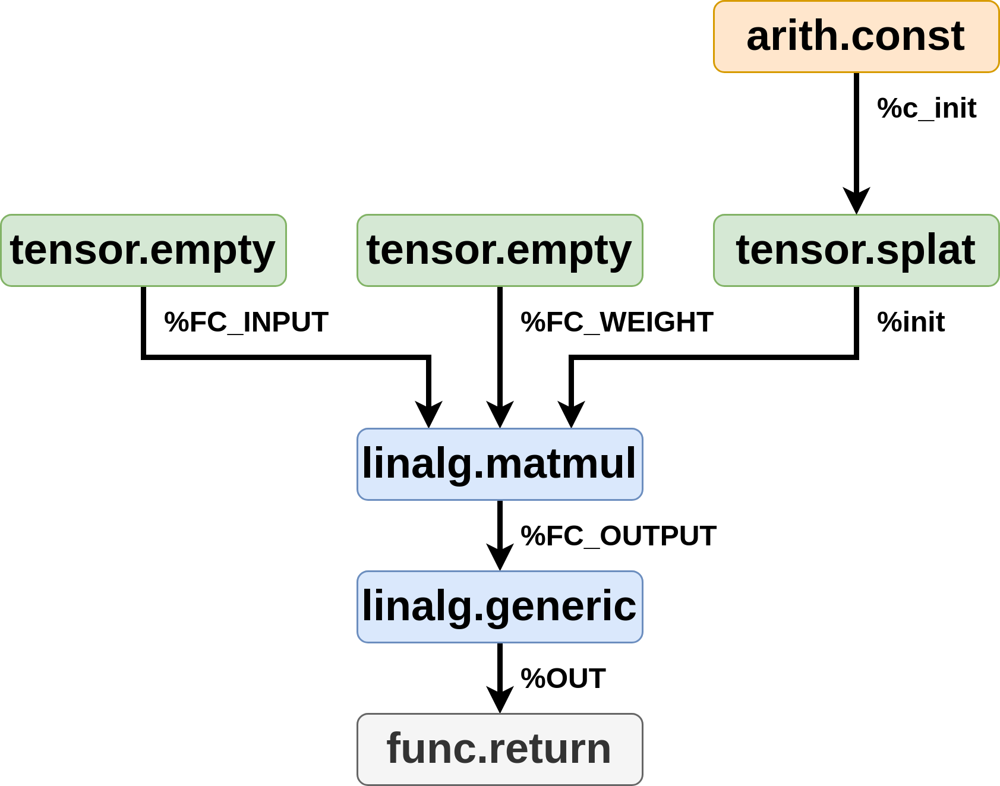

# Chapter 1: Why MLIR, and How to Read Its IR

> Adapted from [mlir-beginner-friendly-tutorial](https://github.com/AlexandreSinger/mlir-beginner-friendly-tutorial) by Alexandre Singer (MIT).

This chapter approaches MLIR from the perspective of a *user* of MLIR, not a
compiler engineer. We first motivate why MLIR exists at all, then read our
first real MLIR file line by line.

> **Tooling note:** all tools in this tutorial (`mlir-opt`, etc.) come from the
> prebuilt MLIR wheel installed in the repo's virtual environment — no LLVM
> source build required. Follow the setup in the [repo root README](../../README.md)
> first; commands below assume the wheel's `bin/` directory
> (`.venv/lib/python3.12/site-packages/mlir_wheel/bin`) is on your `PATH`, or
> that you spell out the full path.

## What you will learn

- Why traditional compilation "lowers too early" for high-performance code,
  and why hand-tuned kernel libraries are painful to build and maintain
- What MLIR's core idea is: multiple levels of abstraction (*dialects*)
  living inside one intermediate representation
- How to read MLIR IR: operations, SSA values, types, regions, and blocks
- The core dialects you will meet constantly: `builtin`, `func`, `tensor`,
  `arith`, and `linalg`
- How `linalg.matmul` and `linalg.generic` work — indexing maps, iterator
  types, and the `ins`/`outs` convention
- Common syntax gotchas: `:` vs `->`, and `ugt` vs `ogt` (NaN handling)
- How to check that IR is valid with `mlir-opt`

## Prerequisites

None — this is the entry point of the tutorial. You should have run the setup
steps in the [repo root README](../../README.md) so the MLIR wheel is
installed.

## Part 1: Why MLIR exists

Let's look at what writing high-performance code is like *without* MLIR. A
very common technique is for the user to write their code at a high level —
just basic linear-algebra operations — and rely on a high-performance library
to make it run fast. This is exactly how TensorFlow and PyTorch work in
Python. Our example is C++ so we can see all the moving parts, but the same
concepts apply.

Here is a basic fully-connected (FC) layer from a deep neural network: an
input matrix multiplied by a weight matrix, followed by a ReLU activation
(full source in [`examples/demo1.cpp`](examples/demo1.cpp)):

```cpp
#include "tensor.h"
#include "linalg_lib.h"

int main(void) {
    // Initialize the FC input and weight matrices. Here we assume they were
    // initialized elsewhere for this demo.
    Tensor<float, 256, 512> FC_INPUT;
    Tensor<float, 512, 1024> FC_WEIGHT;

    // Perform the matrix-multiply and relu function from the FC layer.
    Tensor<float, 256, 1024> FC_OUTPUT = matmul(FC_INPUT, FC_WEIGHT);
    Tensor<float, 256, 1024> OUT = relu(FC_OUTPUT);
}
```

The user writes this without any concern for performance, which makes the
code easy to write and portable to other targets. All the performance lives
in the library — a tensor class ([`examples/tensor.h`](examples/tensor.h))
and a kernel library ([`examples/linalg_lib.h`](examples/linalg_lib.h)). The
version in this repo is the bare minimum, completely unoptimized:

```cpp
/**
 * @brief Perform a matrix-multiplication on two, fixed-shape tensors.
 */
template<typename T, size_t M, size_t K, size_t N>
Tensor<T, M, N> matmul(Tensor<T, M, K>& A, Tensor<T, K, N>& B) {
    Tensor<T, M, N> C;
    for (size_t i = 0; i < M; i++) {
        for (size_t j = 0; j < N; j++) {
            C.get(i, j) = 0.f;
            for (size_t k = 0; k < K; k++) {
                C.get(i, j) += A.get(i, k) * B.get(k, j);
            }
        }
    }
    return C;
}
```

In real deployments, the user has no control over what is inside this library
(often it is shipped only as a binary). Experts on the target architecture
build these libraries using in-depth knowledge of the device — BLAS is the
classic example. The comments in `examples/linalg_lib.h` walk through the
optimizations one would perform on this matmul (tiling for cache, tiling for
registers, vectorization, multi-threading), and every single one requires
in-depth knowledge of the target.

### The trade-off

The benefit of this approach: users do not need to be experts on the device
to get high performance for applications like AI or HPC, and the same
high-level code ports between accelerators and chip generations.

The downside: these hand-tuned libraries are a huge barrier to entry for new
chips, and take enormous time and expertise to build.

The key observation is that the optimizations performed on these kernels are
*often the same*. To get good performance on matmul, everyone tiles — what
changes between devices is *how much* to tile. Ideally the **compiler** would
perform these optimizations, since it knows a great deal about the device
architecture.

### The "lowering too early" problem

The problem is that with traditional compilation, by the time the compiler
sees the code it has already been written as bare `for` loops and raw memory
accesses. The abstraction level was lowered **too early** for the compiler to
recognize "this is a matmul" and apply the well-known high-level
optimizations.

This is where MLIR comes in. **MLIR is a compiler framework which allows
different levels of abstraction ("dialects") to be represented within its
intermediate representation.** Compiler passes can then perform high-level
optimizations on kernels while they are still recognizably kernels. These
passes and dialects, if written well, can be reused by different compiler
flows to achieve good performance on all devices — even hardware
accelerators, which usually stay at very high levels of abstraction.

There are other motivations for MLIR, but this one best captures the
"Multi-Level" in the name.

## Part 2: Entering MLIR

Now let's convert the high-level code from Part 1 into MLIR. In practice,
tools convert user code into MLIR automatically (that is essentially what
torch-mlir does for PyTorch). For this example such a tool would be trivial,
because the C++ library API was deliberately chosen to match the **Linalg on
Tensor** level of abstraction in MLIR. Often people go the other way around —
they build a dialect that matches their pre-existing API — but this tutorial
sticks to core MLIR dialects.

Linalg on Tensor is a great abstraction to enter at: it is what the major
MLIR users (TensorFlow, PyTorch) use, and it is a very interesting level in
its own right.

The hand-translated code lives in [`examples/demo2.mlir`](examples/demo2.mlir).
**That file is the core artifact of this chapter** — it is heavily annotated
with comments explaining how to read the IR, and you should read it
side-by-side with this section. Stripped of comments, it looks like this:

```mlir
#map = affine_map<(i, j) -> (i, j)>
module {
func.func @main() -> tensor<256x1024xf32> {
    %FC_INPUT = tensor.empty() : tensor<256x512xf32>
    %FC_WEIGHT = tensor.empty() : tensor<512x1024xf32>

    %c_init = arith.constant 0.0 : f32
    %matmul_init = tensor.splat %c_init : tensor<256x1024xf32>
    %FC_OUTPUT = linalg.matmul
                    ins(%FC_INPUT, %FC_WEIGHT : tensor<256x512xf32>, tensor<512x1024xf32>)
                    outs(%matmul_init : tensor<256x1024xf32>) -> tensor<256x1024xf32>

    %relu_init = tensor.empty() : tensor<256x1024xf32>
    %OUT = linalg.generic { indexing_maps = [#map, #map],
                            iterator_types = ["parallel", "parallel"]}
               ins(%FC_OUTPUT : tensor<256x1024xf32>)
               outs(%relu_init : tensor<256x1024xf32>) {
               ^bb0(%in: f32, %out: f32):   // ^bb0 => basic block 0
                    %c0 = arith.constant 0.0 : f32
                    %cmp = arith.cmpf ugt, %in, %c0 : f32
                    %sel = arith.select %cmp, %in, %c0 : f32
                    linalg.yield %sel : f32
               } -> tensor<256x1024xf32>

    func.return %OUT : tensor<256x1024xf32>
}
}
```

Let's decode this piece by piece.

### Operations

Everything in MLIR is an **Operation**. Operations have
application-specific semantics — their meaning comes from the dialect that
defines them, not from MLIR itself. An operation has a name
(`dialect.opname`), may return results, may take operands, may carry
attributes, and may have **regions** containing further operations.

Even the outermost `module { ... }` is an operation (from the *builtin*
dialect) — a top-level container with one region holding everything to be
compiled. The compiler uses it to attach whole-program attributes, such as
the target triple.

### Dialects

A **dialect** is a collection of operations (plus types and attributes) at
some level of abstraction. This one file already uses five:

| Dialect   | Role in this file |
|-----------|-------------------|
| `builtin` | MLIR-level organization: `module`, core types like `tensor<...>` and `f32` |
| `func`    | Defining and calling functions: `func.func`, `func.return` |
| `tensor`  | Working with tensor values: `tensor.empty`, `tensor.splat` |
| `arith`   | Scalar arithmetic: `arith.constant`, `arith.cmpf`, `arith.select` |
| `linalg`  | High-level ("graph-level") linear algebra: `linalg.matmul`, `linalg.generic`, `linalg.yield` |

`func.func` defines a function with a name (`@main`), argument types (none
here), and a result type. It contains one region of ops that it "executes" in
order — and note that even this notion of sequential execution comes from the
`func` dialect's semantics, not from MLIR itself.

### SSA values and types

Names starting with `%` are **Values**, the results of operations. MLIR
values are **Static Single Assignment (SSA)**: each is assigned exactly once
and never mutates. This makes the data-flow graph of a function directed and
acyclic, which enables a lot of compiler analysis.

Every value has a **type**. `%FC_INPUT` has type `tensor<256x512xf32>` — a
256×512 tensor of 32-bit floats. Crucially, the Tensor type has **no concept
of memory**: it says nothing about where or how the data is stored. A tensor
is just an abstract "chunk of data", by design. That lets us reason about the
computation without caring how buffers get allocated (that comes in
Chapter 2).

In the C++ version, `FC_INPUT` and `FC_WEIGHT` were default-initialized;
here, `tensor.empty()` creates a tensor of the given shape with undefined
contents.

### `linalg.matmul` and the `outs` quirk

```mlir
%FC_OUTPUT = linalg.matmul
                ins(%FC_INPUT, %FC_WEIGHT : tensor<256x512xf32>, tensor<512x1024xf32>)
                outs(%matmul_init : tensor<256x1024xf32>) -> tensor<256x1024xf32>
```

At this level, all we say is "multiply these two matrices" — nothing about
*how*. But notice we had to create an extra tensor (`%matmul_init`) to pass
as `outs`. This is a quirk of the linalg dialect: most linalg ops need to
know the contents of the output tensor *before* the operation runs, because
some ops don't write every element, and some — like matmul, which is built
from multiply-*accumulate* — accumulate into it. So we build a
zero-initialized tensor with `arith.constant 0.0` + `tensor.splat`, and
matmul accumulates on top of it.

### `linalg.generic`: ReLU from scratch

The linalg dialect has no ReLU op (it is apparently not common enough), but
it has an escape hatch: `linalg.generic`, a way to specify *any* structured
linear-algebra operation. Besides `ins`/`outs`, you specify:

- **`indexing_maps`** — how each operand is indexed as the iteration
  proceeds. Our map, defined at the top of the file as
  `#map = affine_map<(i, j) -> (i, j)>`, says "for iteration point (i, j),
  access element (i, j)" — i.e. read and write the matrices straight through,
  no transpose. There is one map per operand (`ins` first, then `outs`).
- **`iterator_types`** — one entry per loop dimension. `"parallel"` means
  iterations are independent and can run in any order (the other common kind,
  `"reduction"`, appears in ops like matmul's k-loop).
- **A region** — the body, describing what happens at each iteration point:

```mlir
^bb0(%in: f32, %out: f32):
    %c0 = arith.constant 0.0 : f32
    %cmp = arith.cmpf ugt, %in, %c0 : f32
    %sel = arith.select %cmp, %in, %c0 : f32
    linalg.yield %sel : f32
```

`^bb0` is a **block** label (basic block 0). Its arguments `%in` and `%out`
are the current elements of the operands, matched **in order**: `ins` values
first, then `outs`. The names are pure convention — call them anything.
Because ReLU writes every element and never reads `%out`, `%relu_init` can be
a plain `tensor.empty()` with no splat this time.

The body itself uses the `arith` dialect: compare `%in` against zero, select
`%in` if positive else zero, and `linalg.yield` the result as this
iteration's output element.

### Sigils at a glance

MLIR uses a small set of sigils and delimiters to tell the kinds of names
and groups apart. A one-glance reference (adapted from mlir-ir-lowering):

| Sigil | Meaning | Example |
|---|---|---|
| `%` | SSA value | `%result`, `%arg0` |
| `@` | Function / symbol name | `@main` |
| `^` | Basic block label | `^bb0` |
| `#` | Attribute (alias) | `#map = affine_map<(d0) -> (d0)>`, used as `#map` |
| `!` | Dialect type, or a type alias | `!tiny.ptr`; `!avx_m128 = vector<4xf32>` |
| `x` | Shape / element-type delimiter | `10xf32` in `tensor<10xf32>` |
| `:` / `->` | Type annotation / result type | `%r : i32`, `(i32) -> i32` |
| `( )` | Operands / arguments | `(%arg0, %arg1)` |
| `{ }` | Region, or an attribute dictionary | `{ ... }`, `{llvm.emit_c_interface}` |
| `< >` | Type or attribute parameters | `tensor<10xf32>` |
| `//` | Comment | `// like this` |

Aliases (`#name = ...`, `!name = ...`) are defined at the top of a file and
are pure shorthand: `mlir-opt` expands `!avx_m128` back to `vector<4xf32>`
when it prints, and invents its own `#map`-style aliases for long
attributes such as affine maps.

### Syntax gotchas

Some MLIR syntax is genuinely hard to follow at first:

- **`:` vs `->`** — `:` is a type annotation ("this value has this type");
  `->` denotes a mapping or a return type. But `:` on a no-operand op like
  `tensor.empty() : tensor<256x512xf32>` is effectively shorthand for the
  result type — read it as `() -> tensor<256x512xf32>`.
- **`ugt` vs `ogt`** — `arith.cmpf ugt` is *Unordered or Greater Than*: it is
  true if the comparison is unordered (either input is **NaN**) *or* greater
  than. `ogt` is *Ordered Greater Than*: NaN makes it false. Using `ugt` in
  ReLU means NaN inputs propagate through to the output instead of being
  silently clamped to 0 — usually what you want for debugging.

### The data-flow graph

Because tensors are immutable SSA values, we can draw the kernel as a
data-flow graph (DFG):

<div align="center">
  
  <br><b>Figure 1:</b> Linalg on Tensor data-flow graph
</div>
<br>

MLIR's infrastructure includes methods for traversing this DFG, and it has a
special property: it is **directed** and **acyclic**. That has major benefits
for optimization. For example, the matmul result feeds directly into the
ReLU — if our device had a fused MatMul+ReLU instruction (say, a specialized
accelerator), a pass could fuse the two linalg ops directly. This
data-level-DFG property is why this level of abstraction is sometimes called
the **"graph level"**.

### Checking your IR with `mlir-opt`

MLIR ships a tool called `mlir-opt` for testing MLIR code. It runs passes on
IR (Chapter 2 is all about that) and verifies the IR is valid between passes.
Because it verifies so aggressively, it is mostly used for testing and
debugging; production flows build custom tools on the same infrastructure.
Run with no passes, it simply parses, verifies, and re-prints the IR — a
perfect check that hand-written MLIR is valid. From this chapter's directory:

```sh
mlir-opt examples/demo2.mlir
```

Real output from the wheel's `mlir-opt`:

```mlir
#map = affine_map<(d0, d1) -> (d0, d1)>
module {
  func.func @main() -> tensor<256x1024xf32> {
    %0 = tensor.empty() : tensor<256x512xf32>
    %1 = tensor.empty() : tensor<512x1024xf32>
    %cst = arith.constant 0.000000e+00 : f32
    %splat = tensor.splat %cst : tensor<256x1024xf32>
    %2 = linalg.matmul ins(%0, %1 : tensor<256x512xf32>, tensor<512x1024xf32>) outs(%splat : tensor<256x1024xf32>) -> tensor<256x1024xf32>
    %3 = tensor.empty() : tensor<256x1024xf32>
    %4 = linalg.generic {indexing_maps = [#map, #map], iterator_types = ["parallel", "parallel"]} ins(%2 : tensor<256x1024xf32>) outs(%3 : tensor<256x1024xf32>) {
    ^bb0(%in: f32, %out: f32):
      %cst_0 = arith.constant 0.000000e+00 : f32
      %5 = arith.cmpf ugt, %in, %cst_0 : f32
      %6 = arith.select %5, %in, %cst_0 : f32
      linalg.yield %6 : f32
    } -> tensor<256x1024xf32>
    return %4 : tensor<256x1024xf32>
  }
}
```

No error means the IR is valid. Notice what the round-trip did: our
descriptive value names (`%FC_INPUT`, `%OUT`) were renamed to numbered values
(`%0`, `%4`), affine-map dimensions were renamed (`(i, j)` → `(d0, d1)`),
constants were normalized (`0.0` → `0.000000e+00`), and all comments are
gone — none of that carries semantic meaning. Use `-o <file>` to write the
result to a file instead of stdout.

It is worth breaking the file on purpose once to see the verifier work. For
example, changing the return type on the last line to `tensor<256x512xf32>`
produces:

```
demo2.mlir:116:17: error: use of value '%OUT' expects different type than prior uses: 'tensor<256x512xf32>' vs 'tensor<256x1024xf32>'
    func.return %OUT : tensor<256x512xf32>
                ^
demo2.mlir:101:5: note: prior use here
    %OUT = linalg.generic { indexing_maps = [#map, #map],
    ^
```

MLIR's verifier errors are precise and point at both sides of the conflict —
you will come to appreciate this a lot when writing IR by hand.

## Recap

- Hand-tuned kernel libraries deliver performance but are expensive to build,
  and traditional compilers can't help because the abstraction was lowered
  too early.
- MLIR keeps multiple abstraction levels — dialects — inside one IR, so
  compiler passes can optimize a matmul *as a matmul*.
- MLIR IR is built from operations carrying regions, blocks, and SSA values,
  every value has a type, and `mlir-opt` verifies it all.
- The Linalg-on-Tensor level describes *what* to compute (a DAG of
  linear-algebra ops on memory-less tensors) and nothing about *how*.

## Where to go next

The IR in this chapter says nothing about memory, loops, or instructions —
so how does it ever become something a CPU can execute? Continue to
[Chapter 2: Lowering Pipelines](../ch02-lowering-pipelines/README.md), which
takes exactly this kernel and lowers it step by step — tensors to buffers
(bufferization), linalg to loops, loops to branches, and finally to the LLVM
dialect.
