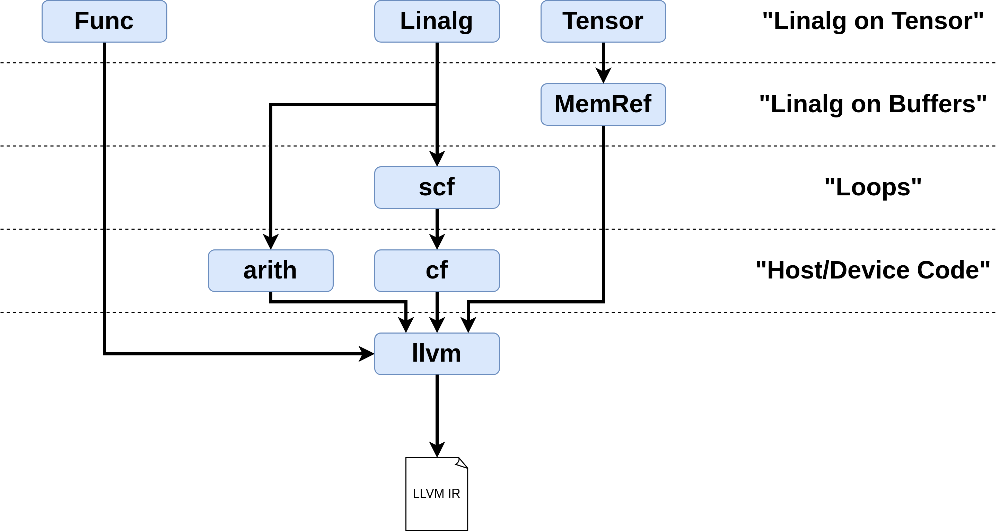

# Chapter 2: Lowering Pipelines with mlir-opt

> Part A of this chapter is adapted from chapter 1 of this project's own
> [mlir-tutorial fork](https://github.com/roykim0823/mlir-tutorial)
> ("MLIR Basics and Running a Lowering"). Part B is adapted from "Demo 3:
> Lowering MLIR" of Alexandre Singer's
> [mlir-beginner-friendly-tutorial](https://github.com/AlexandreSinger/mlir-beginner-friendly-tutorial)
> (MIT License), including the dialect diagram and the matmul+relu example.
> All commands and IR listings have been re-run against the MLIR wheel this
> repo builds on (LLVM 24 at the time of writing), so what you see here is
> what you will get.

Chapter 1 showed why MLIR has many dialects and how to read its IR. This
chapter puts that knowledge to work with `mlir-opt`, the command-line tool for
running passes. We start small — one op, one pass — and finish by driving a
real machine-learning kernel (matrix multiply + ReLU) all the way from
tensor-level IR down to LLVM IR, one lowering stage at a time.

**What you will learn:**

- What a *lowering* (conversion pass) is, and why compilation in MLIR is a
  chain of them.
- The anatomy of an `mlir-opt` invocation: pass flags, pass options, and
  useful inspection flags (`--show-dialects`, `--mlir-print-op-generic`).
- How the verifier catches type errors, and how to read its diagnostics.
- A first lowering: `math.ctlz` → `scf`/`arith` via `--convert-math-to-funcs`.
- A realistic pipeline: `linalg` on tensors → bufferization → loops →
  branches → `llvm` dialect → (via `mlir-translate`) real LLVM IR.

**Prerequisites:**
[Chapter 1](../ch01-why-mlir-and-reading-ir/README.md), and a working
environment as described in the [root README](../../README.md). All tools used
here (`mlir-opt`, `mlir-translate`) come from the MLIR pip wheel; with the
repo's virtualenv activated they are on your `PATH`. Commands below are
written to be run from the repository root.

---

## Part A: MLIR basics and a first lowering

### 1. Dialects and lowerings

A traditional compiler like LLVM has essentially **one** intermediate
representation (IR): the input language is translated into LLVM IR, all
optimizations happen there, and then machine code is emitted.

MLIR ("Multi-Level IR") instead splits compilation into many smaller steps
between many small IRs. Its two central concepts: **Dialects** and **Lowering**

- A **dialect** is a self-contained set of operations (and possibly types)
  with defined semantics. Dialects can sit at very different levels of
  abstraction. In this chapter you will meet:
  - [`func`](https://mlir.llvm.org/docs/Dialects/Func/) — function
    definitions, calls, and returns (`func.func`, `func.call`,
    `func.return`).
  - [`math`](https://mlir.llvm.org/docs/Dialects/MathOps/) — high-level math
    operations like `math.ctlz` ("count leading zeros").
  - [`arith`](https://mlir.llvm.org/docs/Dialects/ArithOps/) — basic
    arithmetic and comparisons (`arith.constant`, `arith.addi`, `arith.cmpi`).
  - [`linalg`](https://mlir.llvm.org/docs/Dialects/Linalg/) — structured
    linear-algebra operations (`linalg.matmul`, `linalg.generic`), the level
    at which ML frameworks usually enter MLIR.
  - [`tensor`](https://mlir.llvm.org/docs/Dialects/TensorOps/) and
    [`memref`](https://mlir.llvm.org/docs/Dialects/MemRef/) — abstract values
    versus allocated buffers; the difference drives Part B.
  - [`scf`](https://mlir.llvm.org/docs/Dialects/SCFDialect/) — *structured
    control flow*: loops and conditionals that are still visible as loops and
    conditionals (`scf.for`, `scf.if`, `scf.yield`).
  - [`cf`](https://mlir.llvm.org/docs/Dialects/ControlFlowDialect/) —
    *unstructured control flow*: basic blocks and branches, one step closer
    to assembly.
  - [`llvm`](https://mlir.llvm.org/docs/Dialects/LLVM/) — an MLIR mirror of
    LLVM IR, the exit door out of MLIR.

- A **lowering** (or *conversion pass*) rewrites operations from one dialect
  into equivalent operations of lower-level dialects. Compilation in MLIR is
  a chain of lowerings — in Part A: `math` → `scf`/`arith`; in Part B:
  `linalg`-on-`tensor` → `linalg`-on-`memref` → `scf` → `cf` → `llvm` →
  (out of MLIR) → LLVM IR → machine code.

Why bother with many levels? Because some optimizations are easy at a high
level and nearly impossible at a low level. A classic example is loop
optimization: once loops have been lowered to compares and branch
instructions, an optimizer must painstakingly *re-discover* the loop
structure before it can do anything clever. MLIR's answer is to keep the
program at the right abstraction level for each optimization (e.g., the
`affine` dialect exists specifically for polyhedral loop optimizations — the
subject of [Chapter 5](../ch05-affine-optimization/README.md)), and only
lower when that level has nothing more to offer.

You can ask `mlir-opt` which dialects it knows about:

```sh
mlir-opt --show-dialects
```

```
Available Dialects: acc,affine,amdgpu,arith,arm_neon,arm_sme,arm_sve,async,bufferization,builtin,cf,complex,dlti,emitc,func,gpu,index,irdl,linalg,llvm,math,memref,ml_program,mpi,nvgpu,nvvm,omp,pdl,pdl_interp,ptr,quant,rocdl,scf,shape,shard,smt,sparse_tensor,spirv,tensor,tosa,transform,ub,vector,wasmssa,x86,xegpu,xevm
```

Forty-plus dialects, from GPU targets (`nvvm`, `rocdl`, `spirv`) to ML
front-end levels (`tosa`, `linalg`) to solver IRs (`smt`). This chapter only
needs the handful listed above.

### 2. The example program

Here is a small program using the high-level `math.ctlz` operation, which
counts the leading zero bits of an integer. The repo keeps it as a lit test
in [`test/part1/ctlz_simple.mlir`](../../test/part1/ctlz_simple.mlir) (the
`// RUN:` and `// CHECK:` comments in that file are testing directives —
[Chapter 9](../ch09-testing-with-lit/README.md) explains them; ignore them
for now):

```mlir
func.func @main(%arg0: i32) -> i32 {
  %0 = math.ctlz %arg0 : i32
  func.return %0 : i32
}
```

A quick refresher on the syntax from Chapter 1:

- `func.func @main(...)` — the operation `func` from the `func` dialect
  defines a function named `@main`. Every operation is written
  `dialect.opname`.
- `%arg0`, `%0` — SSA values ("static single assignment": each value is
  assigned exactly once, ever; transformations rewire *uses* of values rather
  than mutating them).
- `: i32` — operations are explicitly typed; `i32` is a 32-bit integer.

In fact every line of MLIR has the same shape. Taking the middle line apart:

```
   %0     =  math.ctlz   %arg0   :   i32
   └─┬─┘     └───┬────┘   └─┬─┘      └┬─┘
  result    dialect.op   operand    type
```

An operation consumes zero or more operands (SSA values) and produces zero or
more results; the trailing type annotation says what flows through. (The
[LangRef section on operations](https://mlir.llvm.org/docs/LangRef/#operations)
gives the complete spec of this structure.) There is no expression nesting
like `f(g(x))` — every intermediate result gets a name on its own line. When
you meet an unfamiliar op, the
[dialect documentation](https://mlir.llvm.org/docs/Dialects/) lists every op
with its operands, results, and semantics —
[`math.ctlz`](https://mlir.llvm.org/docs/Dialects/MathOps/#mathctlz-mathcountleadingzerosop)
has its own entry.

Notice what this program does *not* say: how to actually count leading zeros.
`math.ctlz` states the intent and nothing more. Some hardware has a dedicated
instruction for it — but if we're targeting hardware that doesn't, something
must eventually spell out the algorithm in terms of simpler operations. That
is a job for a lowering, and we'll watch one do it in section 4.

### 3. Running mlir-opt with no passes

`mlir-opt` is the command-line entry point for running passes on MLIR code
(analogous to LLVM's `opt`). Run it on the test file with no passes at all:

```sh
mlir-opt test/part1/ctlz_simple.mlir
```

Output (comments from the file are stripped; ignore them):

```mlir
module {
  func.func @main(%arg0: i32) -> i32 {
    %0 = math.ctlz %arg0 : i32
    return %0 : i32
  }
}
```

Even with no passes, `mlir-opt` did three useful things:

1. **Parsed** the input (a syntax check),
2. **Verified** it (type checking and per-operation invariants),
3. **Normalized** it (wrapped everything in a top-level `module`, printed
   `return` in its shorthand form).

So `mlir-opt some_file.mlir` with no flags is a quick way to check "is this
valid MLIR?"

It's worth seeing the verifier catch something. Put this in a scratch file,
say `bad_types.mlir` — it multiplies an `i32` by an `i64`, which `arith.muli`
forbids (its operands must have matching types):

```mlir
func.func @bad(%a: i32, %b: i64) -> i32 {
  %0 = arith.muli %a, %b : i32
  func.return %0 : i32
}
```

```
bad_types.mlir:2:23: error: use of value '%b' expects different type than prior uses: 'i32' vs 'i64'
  %0 = arith.muli %a, %b : i32
                      ^
bad_types.mlir:1:25: note: prior use here
func.func @bad(%a: i32, %b: i64) -> i32 {
                        ^
```

Every operation carries a source location, so errors point at the exact line
and column — you will meet these diagnostics constantly while working with
MLIR, and it pays to have seen a healthy one first.

One more instructive flag before we move on. The nicely readable syntax above
is per-op sugar (the "custom assembly format"). Underneath, *every* operation
has the same uniform structure, which you can display with
`--mlir-print-op-generic`:

```sh
mlir-opt --mlir-print-op-generic test/part1/ctlz_simple.mlir
```

```mlir
"builtin.module"() ({
  "func.func"() <{function_type = (i32) -> i32, sym_name = "main"}> ({
  ^bb0(%arg0: i32):
    %0 = "math.ctlz"(%arg0) : (i32) -> i32
    "func.return"(%0) : (i32) -> ()
  }) : () -> ()
}) : () -> ()
```

Read this once and MLIR loses most of its mystery: an operation is a name in
quotes, a list of operand values in parens, a dictionary of static
*attributes* in `<{...}>` (the function's name and type are just data!), and
optionally a brace-enclosed
[*region*](https://mlir.llvm.org/docs/LangRef/#regions) of code — which is
how "a module contains functions" and "a function contains a body" are
modeled. Even `module` is an ordinary operation. The `^bb0(...)` label names
the entry [*block*](https://mlir.llvm.org/docs/LangRef/#blocks) of the
function's region — a block is a list of operations with exactly one entry
and one exit point (the classical compiler notion of a *basic block*). Blocks
become important when we lower to branch-based control flow in Part B.

### 4. Applying the lowering

MLIR has an upstream pass that converts `math` operations into function-based
implementations: `--convert-math-to-funcs`. Its `convert-ctlz` option enables
the ctlz conversion. Pass options are attached with `=` (multiple options are
space-separated inside quotes — Part B has an example):

```sh
mlir-opt --convert-math-to-funcs=convert-ctlz test/part1/ctlz_simple.mlir
```

Output (exact SSA value names may differ):

```mlir
module {
  func.func @main(%arg0: i32) -> i32 {
    %0 = call @__mlir_math_ctlz_i32(%arg0) : (i32) -> i32
    return %0 : i32
  }
  func.func private @__mlir_math_ctlz_i32(%arg0: i32) -> i32 attributes {llvm.linkage = #llvm.linkage<linkonce_odr>} {
    %c32_i32 = arith.constant 32 : i32
    %c0_i32 = arith.constant 0 : i32
    %0 = arith.cmpi eq, %arg0, %c0_i32 : i32
    %1 = scf.if %0 -> (i32) {
      scf.yield %c32_i32 : i32
    } else {
      %c1 = arith.constant 1 : index
      %c1_i32 = arith.constant 1 : i32
      %c32 = arith.constant 32 : index
      %c0_i32_0 = arith.constant 0 : i32
      %2:2 = scf.for %arg1 = %c1 to %c32 step %c1 iter_args(%arg2 = %arg0, %arg3 = %c0_i32_0) -> (i32, i32) {
        %3 = arith.cmpi slt, %arg2, %c0_i32 : i32
        %4:2 = scf.if %3 -> (i32, i32) {
          scf.yield %arg2, %arg3 : i32, i32
        } else {
          %5 = arith.addi %arg3, %c1_i32 : i32
          %6 = arith.shli %arg2, %c1_i32 : i32
          scf.yield %6, %5 : i32, i32
        }
        scf.yield %4#0, %4#1 : i32, i32
      }
      scf.yield %2#1 : i32
    }
    return %1 : i32
  }
}
```

This is the lowering in action: **two programs, same meaning**. The
`math.ctlz` op is gone from `@main`, replaced by a call to a generated
private function `@__mlir_math_ctlz_i32` — and that function spells out the
algorithm using only the lower-level `scf` and `arith` dialects, exactly the
code we would otherwise have had to write by hand.

**The algorithm:** if the input is 0, the answer is 32; otherwise shift left
one bit at a time, counting iterations, until the top bit becomes 1 (i.e.,
the value becomes negative when read as signed).

The generated code introduces several new syntax elements worth reading
slowly:

- `index` is a distinct type from `i32`: a platform-dependent integer used
  for loop bounds and indexing (like `size_t` in C). The loop counter is an
  `index`; the values being computed are `i32`.
- The loop header:

  ```mlir
  %2:2 = scf.for %arg1 = %c1 to %c32 step %c1
      iter_args(%arg2 = %arg0, %arg3 = %c0_i32_0) -> (i32, i32) {
  ```

  `iter_args` are loop-carried values. Since SSA values can't be
  reassigned, the loop threads its state (`%arg2`, the shifting copy of
  the input, and `%arg3`, the running count) through `iter_args`, and each
  iteration `scf.yield`s the next state. `%2:2 = scf.for ...` is an
  operation returning two results; `%2#0` and `%2#1` access them.
- The generated function's signature line:

  ```mlir
  func.func private @__mlir_math_ctlz_i32(%arg0: i32) -> i32
      attributes {llvm.linkage = #llvm.linkage<linkonce_odr>}
  ```

  The function is private to the module, and carries an attribute telling
  the eventual LLVM backend to deduplicate identical copies of it across
  compilation units (`linkonce_odr`), since every module that lowers a ctlz
  gets its own copy.

Every registered pass gets its own command-line flag like
`--convert-math-to-funcs`. The MLIR documentation keeps a
[complete list of passes](https://mlir.llvm.org/docs/Passes/) owned by the
upstream project — this wheel's `mlir-opt --help` lists 79 `--convert-*`
conversion passes alone. You can chain several passes as repeated flags
(Part B does exactly this), or use `--pass-pipeline` for precise control.

This exact lowering is captured as two lit tests in this repo,
[`test/part1/ctlz.mlir`](../../test/part1/ctlz.mlir) and
[`test/part1/ctlz_simple.mlir`](../../test/part1/ctlz_simple.mlir), so it can
never silently break. How those tests work is the subject of
[Chapter 9](../ch09-testing-with-lit/README.md).

---

## Part B: A realistic pipeline — linalg to LLVM

One pass was enough for `math.ctlz`. Real programs enter MLIR at a much
higher level and need a *pipeline* of lowerings. Our example is the classic
tail of a neural-network layer — a matrix multiply followed by a ReLU
activation — expressed in the `linalg` dialect on `tensor` values. We will
lower it stage by stage until it leaves MLIR as LLVM IR, deliberately
ignoring optimization (that's Chapter 5) and focusing on how the abstraction
level drops at each step.

When working with MLIR it is a good idea to draw a flow diagram of how
dialects convert into one another (upstream does this too, e.g. for the
[vector dialect](https://mlir.llvm.org/docs/Dialects/Vector/#positioning-in-the-codegen-infrastructure)).
Here is the diagram for our pipeline, from the original tutorial:

<div align="center">
  
  <br><b>Figure:</b> dialect lowering flow for this pipeline (source:
  Alexandre Singer, mlir-beginner-friendly-tutorial)
</div>

Each dashed line is one conversion pass. The whole pipeline is scripted in
[`examples/lower.sh`](examples/lower.sh); running it regenerates every
intermediate file in [`examples/`](examples/):

```sh
bash part1-using-mlir/ch02-lowering-pipelines/examples/lower.sh
```

The stage files are numbered `0` (input) through `5` (LLVM IR), and every
listing below is taken verbatim from them. The per-stage commands are shown
relative to this chapter's directory, so if you want to run them one at a
time, `cd part1-using-mlir/ch02-lowering-pipelines` first. Let's walk the
stages.

### Stage 0: linalg on tensor

The input, [`examples/0-linalg-on-tensor.mlir`](examples/0-linalg-on-tensor.mlir),
computes `relu(A × B)` for a 256×512 matrix `A` and a 512×1024 matrix `B`:

```mlir
#map = affine_map<(d0, d1) -> (d0, d1)>
module {
  func.func @main() -> tensor<256x1024xf32> {
    %0 = tensor.empty() : tensor<256x512xf32>
    %1 = tensor.empty() : tensor<512x1024xf32>
    %cst = arith.constant 0.000000e+00 : f32
    %splat = tensor.splat %cst : tensor<256x1024xf32>
    %2 = linalg.matmul ins(%0, %1 : tensor<256x512xf32>, tensor<512x1024xf32>) outs(%splat : tensor<256x1024xf32>) -> tensor<256x1024xf32>
    %3 = tensor.empty() : tensor<256x1024xf32>
    %4 = linalg.generic {indexing_maps = [#map, #map], iterator_types = ["parallel", "parallel"]} ins(%2 : tensor<256x1024xf32>) outs(%3 : tensor<256x1024xf32>) {
    ^bb0(%in: f32, %out: f32):
      %cst_0 = arith.constant 0.000000e+00 : f32
      %5 = arith.cmpf ugt, %in, %cst_0 : f32
      %6 = arith.select %5, %in, %cst_0 : f32
      linalg.yield %6 : f32
    } -> tensor<256x1024xf32>
    return %4 : tensor<256x1024xf32>
  }
}
```

Two ops carry the whole computation: a named `linalg.matmul`, and a
`linalg.generic` whose region computes `max(x, 0)` element-wise (the ReLU).
At this abstraction level there is no concept of what device the code will
run on. Tensors, by design, say nothing about how data is laid out in
memory, and the linalg ops say nothing about how the linear algebra will
actually be performed. It is a high-level description of an algorithm,
nothing more.

### Stage 1: bufferization — tensors become memrefs

Since we are targeting a CPU, we cannot stay at the tensor abstraction: every
chunk of data needs an allocated buffer somewhere in memory. The
[`one-shot-bufferize`](https://mlir.llvm.org/docs/Passes/#-one-shot-bufferize)
pass bufferizes all dialects at once ("one shot"); `canonicalize` then tidies
the result. (Canonicalization is a general-purpose cleanup driver — constant
folding, algebraic simplification, dead-code elimination, per-op rewrite
patterns — and you will sprinkle it between stages of almost every pipeline.)

```sh
mlir-opt examples/0-linalg-on-tensor.mlir \
    --one-shot-bufferize="bufferize-function-boundaries=true" \
    --canonicalize \
    -o examples/1-linalg-on-memref.mlir
```

Result, [`examples/1-linalg-on-memref.mlir`](examples/1-linalg-on-memref.mlir)
("linalg on buffers"):

```mlir
#map = affine_map<(d0, d1) -> (d0, d1)>
module {
  func.func @main() -> memref<256x1024xf32> {
    %cst = arith.constant 0.000000e+00 : f32
    %alloc = memref.alloc() {alignment = 64 : i64} : memref<256x512xf32>
    %alloc_0 = memref.alloc() {alignment = 64 : i64} : memref<512x1024xf32>
    %alloc_1 = memref.alloc() {alignment = 64 : i64} : memref<256x1024xf32>
    linalg.map outs(%alloc_1 : memref<256x1024xf32>)
      (%init: f32) {
        linalg.yield %cst : f32
      }
    linalg.matmul ins(%alloc, %alloc_0 : memref<256x512xf32>, memref<512x1024xf32>) outs(%alloc_1 : memref<256x1024xf32>)
    %alloc_2 = memref.alloc() {alignment = 64 : i64} : memref<256x1024xf32>
    linalg.generic {indexing_maps = [#map, #map], iterator_types = ["parallel", "parallel"]} ins(%alloc_1 : memref<256x1024xf32>) outs(%alloc_2 : memref<256x1024xf32>) {
    ^bb0(%in: f32, %out: f32):
      %0 = arith.cmpf ugt, %in, %cst : f32
      %1 = arith.select %0, %in, %cst : f32
      linalg.yield %1 : f32
    }
    return %alloc_2 : memref<256x1024xf32>
  }
}
```

We can no longer conjure empty tensors — memory is actually allocated
(`memref.alloc`), and the `tensor.splat` that filled the accumulator with
zeros became an explicit `linalg.map` writing into a buffer. A **memref** is
a pointer with shape and layout information attached. Memrefs "break" SSA in
a practical sense: the memref value itself (`%alloc`) is still SSA, but code
can now *store into* the memory it points to without producing a new value —
which makes data-flow analysis on the buffer contents much harder. Moving
down an abstraction level always trades away information like this.

Note also that `linalg.matmul` no longer returns a result: on buffers it
writes into its `outs` operand directly.

### Stage 2: linalg ops become scf loops

CPUs (normally) have no instruction that multiplies whole matrices, so the
named kernels must become explicit loop nests. The
[`convert-linalg-to-loops`](https://mlir.llvm.org/docs/Passes/#-convert-linalg-to-loops)
pass emits `scf.for` loops:

```sh
mlir-opt examples/1-linalg-on-memref.mlir \
    --convert-linalg-to-loops \
    -o examples/2-scf-loops.mlir
```

Result, [`examples/2-scf-loops.mlir`](examples/2-scf-loops.mlir):

```mlir
module {
  func.func @main() -> memref<256x1024xf32> {
    %c512 = arith.constant 512 : index
    %c1024 = arith.constant 1024 : index
    %c1 = arith.constant 1 : index
    %c256 = arith.constant 256 : index
    %c0 = arith.constant 0 : index
    %cst = arith.constant 0.000000e+00 : f32
    %alloc = memref.alloc() {alignment = 64 : i64} : memref<256x512xf32>
    %alloc_0 = memref.alloc() {alignment = 64 : i64} : memref<512x1024xf32>
    %alloc_1 = memref.alloc() {alignment = 64 : i64} : memref<256x1024xf32>
    scf.for %arg0 = %c0 to %c256 step %c1 {
      scf.for %arg1 = %c0 to %c1024 step %c1 {
        memref.store %cst, %alloc_1[%arg0, %arg1] : memref<256x1024xf32>
      }
    }
    scf.for %arg0 = %c0 to %c256 step %c1 {
      scf.for %arg1 = %c0 to %c1024 step %c1 {
        scf.for %arg2 = %c0 to %c512 step %c1 {
          %0 = memref.load %alloc[%arg0, %arg2] : memref<256x512xf32>
          %1 = memref.load %alloc_0[%arg2, %arg1] : memref<512x1024xf32>
          %2 = memref.load %alloc_1[%arg0, %arg1] : memref<256x1024xf32>
          %3 = arith.mulf %0, %1 : f32
          %4 = arith.addf %2, %3 : f32
          memref.store %4, %alloc_1[%arg0, %arg1] : memref<256x1024xf32>
        }
      }
    }
    %alloc_2 = memref.alloc() {alignment = 64 : i64} : memref<256x1024xf32>
    scf.for %arg0 = %c0 to %c256 step %c1 {
      scf.for %arg1 = %c0 to %c1024 step %c1 {
        %0 = memref.load %alloc_1[%arg0, %arg1] : memref<256x1024xf32>
        %1 = arith.cmpf ugt, %0, %cst : f32
        %2 = arith.select %1, %0, %cst : f32
        memref.store %2, %alloc_2[%arg0, %arg1] : memref<256x1024xf32>
      }
    }
    return %alloc_2 : memref<256x1024xf32>
  }
}
```

This is practically the textbook C triple loop for matmul, plus a double loop
for the ReLU — but as IR. We now operate on buffers with explicit
`memref.load`/`memref.store`, and the kernel got noticeably longer. That is
the general pattern: lower abstraction means more detail and more code.

### Stage 3: scf loops become cf branches

Assembly has no `for` loops — CPUs implement loops with compare-and-branch.
The [`convert-scf-to-cf`](https://mlir.llvm.org/docs/Passes/#-convert-scf-to-cf)
pass rewrites structured control flow into basic blocks and branches in the
`cf` dialect:

```sh
mlir-opt examples/2-scf-loops.mlir \
    --convert-scf-to-cf \
    -o examples/3-cf-branches.mlir
```

Excerpt of [`examples/3-cf-branches.mlir`](examples/3-cf-branches.mlir) — the
first (zero-fill) loop nest; the full file has 21 blocks:

```mlir
    cf.br ^bb1(%c0 : index)
  ^bb1(%0: index):  // 2 preds: ^bb0, ^bb5
    %1 = arith.cmpi slt, %0, %c256 : index
    cf.cond_br %1, ^bb2, ^bb6
  ^bb2:  // pred: ^bb1
    cf.br ^bb3(%c0 : index)
  ^bb3(%2: index):  // 2 preds: ^bb2, ^bb4
    %3 = arith.cmpi slt, %2, %c1024 : index
    cf.cond_br %3, ^bb4, ^bb5
  ^bb4:  // pred: ^bb3
    memref.store %cst, %alloc_1[%0, %2] : memref<256x1024xf32>
    %4 = arith.addi %2, %c1 : index
    cf.br ^bb3(%4 : index)
  ^bb5:  // pred: ^bb3
    %5 = arith.addi %0, %c1 : index
    cf.br ^bb1(%5 : index)
```

Here are the blocks (`^bb1`, ...) from Part A section 3 in earnest, with
*block arguments* (`^bb1(%0: index)`) playing the role of LLVM's phi nodes:
each loop counter arrives as an argument of its loop-header block. Every
`scf.for` became a header block (compare + conditional branch), a body block,
and an increment-and-jump-back block.

Notice how much was lost: nothing in this IR says "these blocks form nested
loops over a 256×1024 space" anymore — an optimizer would have to re-derive
that. This is the key idea of MLIR restated: **perform each optimization at
the abstraction level where it is convenient, never later.** From here on we
are as close to a CPU as core MLIR gets.

### Stage 4: everything becomes the llvm dialect

Now we hand off to LLVM, which has decades of backend work for turning
CPU-level code into machine code. To emit LLVM IR we first convert every
remaining dialect (`func`, `cf`, `memref`, `arith`) into the `llvm` dialect.
Each has its own conversion pass, chained in a single invocation:

```sh
mlir-opt examples/3-cf-branches.mlir \
    --convert-func-to-llvm \
    --convert-cf-to-llvm \
    --finalize-memref-to-llvm \
    --convert-arith-to-llvm \
    --reconcile-unrealized-casts \
    --canonicalize \
    -o examples/4-llvm-dialect.mlir
```

Two of these deserve explanation:

- `--finalize-memref-to-llvm` lowers memrefs to their LLVM-level reality: a
  *descriptor* struct `(allocated ptr, aligned ptr, offset, sizes[2],
  strides[2])`, with `memref.alloc` becoming a `malloc` call plus manual
  alignment arithmetic.
- `--reconcile-unrealized-casts` cleans up after the others. Each conversion
  pass runs independently and cannot know how *other* dialects' types get
  lowered, so mid-pipeline the IR is stitched together with temporary
  `builtin.unrealized_conversion_cast` "bridge" ops between old and new
  types (e.g. `i64 to index` immediately followed by `index to i64`). Once
  every dialect is converted the bridges cancel out pairwise, and this pass
  deletes them. If any survive, `mlir-translate` fails with
  `error: LLVM Translation failed for operation: builtin.unrealized_conversion_cast`
  (exercise 4 lets you see this).

Excerpt of [`examples/4-llvm-dialect.mlir`](examples/4-llvm-dialect.mlir):

```mlir
module {
  llvm.func @malloc(i64) -> !llvm.ptr
  llvm.func @main() -> !llvm.struct<(ptr, ptr, i64, array<2 x i64>, array<2 x i64>)> {
    %0 = llvm.mlir.poison : !llvm.struct<(ptr, ptr, i64, array<2 x i64>, array<2 x i64>)>
    %1 = llvm.mlir.constant(64 : index) : i64
    %2 = llvm.mlir.constant(512 : index) : i64
    %3 = llvm.mlir.constant(1024 : index) : i64
    %4 = llvm.mlir.constant(1 : index) : i64
    %5 = llvm.mlir.constant(256 : index) : i64
    %6 = llvm.mlir.constant(0 : index) : i64
    %7 = llvm.mlir.constant(0.000000e+00 : f32) : f32
    %8 = llvm.mlir.zero : !llvm.ptr
    %9 = llvm.getelementptr %8[131072] : (!llvm.ptr) -> !llvm.ptr, f32
    %10 = llvm.ptrtoint %9 : !llvm.ptr to i64
    %11 = llvm.add %10, %1 : i64
    %12 = llvm.call @malloc(%11) : (i64) -> !llvm.ptr
    %13 = llvm.ptrtoint %12 : !llvm.ptr to i64
    ...
```

Every op is now `llvm.*` — this is LLVM IR wearing MLIR syntax. The function
returns the 5-field memref descriptor struct, and you can read off the size
computation for the first buffer: 131072 elements (256×512 floats) plus 64
bytes of slack for alignment.

### Stage 5: leaving MLIR — mlir-translate

The final step uses a different tool. `mlir-opt` always maps valid MLIR to
valid MLIR; **`mlir-translate`** crosses the boundary between MLIR and other
formats — here, from llvm-dialect MLIR to real LLVM IR:

```sh
mlir-translate examples/4-llvm-dialect.mlir \
    --mlir-to-llvmir \
    -o examples/5-llvm-ir.ll
```

Excerpt of [`examples/5-llvm-ir.ll`](examples/5-llvm-ir.ll):

```llvm
; ModuleID = 'LLVMDialectModule'
source_filename = "LLVMDialectModule"

declare ptr @malloc(i64)

define { ptr, ptr, i64, [2 x i64], [2 x i64] } @main() {
  %1 = call ptr @malloc(i64 524352)
  %2 = ptrtoint ptr %1 to i64
  %3 = add i64 %2, 63
  %4 = urem i64 %3, 64
  %5 = sub i64 %3, %4
  %6 = inttoptr i64 %5 to ptr
  %7 = call ptr @malloc(i64 2097216)
  ...
  br label %19

19:                                               ; preds = %31, %0
  %20 = phi i64 [ %32, %31 ], [ 0, %0 ]
  %21 = icmp slt i64 %20, 256
  br i1 %21, label %22, label %33
  ...
```

No more dialects, no more regions — plain LLVM IR. The block arguments became
genuine `phi` nodes, and the malloc sizes are fully constant-folded
(524352 = 256·512·4 + 64). From here the standard LLVM toolchain takes over:
`opt` for optimization, `llc`/`clang` for machine code. The wheel used by
this repo ships no `llc`, so when Part 4 needs a native binary it compiles
with `clang -x ir`; for this chapter, reaching valid LLVM IR is the finish
line.

### Recap: the whole pipeline at a glance

| Stage | File | Dialects | What it represents |
|---|---|---|---|
| 0 | `0-linalg-on-tensor.mlir` | linalg, tensor, arith | the algorithm, device-agnostic |
| 1 | `1-linalg-on-memref.mlir` | linalg, memref, arith | data lives in allocated buffers |
| 2 | `2-scf-loops.mlir` | scf, memref, arith | kernels are explicit loop nests |
| 3 | `3-cf-branches.mlir` | cf, memref, arith | loops are blocks and branches |
| 4 | `4-llvm-dialect.mlir` | llvm | LLVM IR in MLIR clothing |
| 5 | `5-llvm-ir.ll` | — | real LLVM IR, out of MLIR |

> **A note on pass-name drift.** Pass names and options change between MLIR
> releases. Every name in this chapter was verified against this wheel's
> `mlir-opt --help` (LLVM 24): `one-shot-bufferize`,
> `convert-linalg-to-loops`, `convert-scf-to-cf`, `convert-func-to-llvm`,
> `convert-cf-to-llvm`, `finalize-memref-to-llvm`, `convert-arith-to-llvm`,
> and `reconcile-unrealized-casts` are all current. If a flag goes missing
> after a wheel upgrade, `mlir-opt --help | grep <keyword>` finds its new
> name. Printed output drifts too: compared with the March-2025 original of
> this demo, the wheel now prints `linalg.map`'s block argument as
> `(%init: f32)` where it used to print `()` — same op, newer printer.

## Where to go next

Stage 5 stopped at LLVM IR. [Chapter 3](../ch03-llvm-ir-and-native-code/README.md)
takes it the rest of the way: native objects, shared libraries and a JIT,
plus a tour of the standard dialects you just lowered through.
[Chapter 4](../ch04-memory-and-the-c-abi/README.md) then looks closely at
what bufferization produced: tensors, memrefs, and the C ABI for calling
compiled kernels with real data.

We also deliberately lowered without optimizing — stage 2's naive triple loop
would be embarrassingly slow. [Chapter 5](../ch05-affine-optimization/README.md)
shows how MLIR optimizes *before* lowering, using the `affine` dialect's loop
analyses (tiling, fusion) at the level where loop structure is still visible.
And to make sure a lowering keeps working as code and toolchains evolve,
[Chapter 9](../ch09-testing-with-lit/README.md) introduces `lit` and
`FileCheck` — the testing tools behind `test/part1/ctlz.mlir` and the rest of
this repo's test suite.

**Exercises**

1. Write a small function of your own using `arith.muli` (integer
   multiplication) and check it with `mlir-opt`. Then break it in ways
   *different* from the section-3 demo and read each diagnostic: return an
   `i64` from a function declared `-> i32`; use a value `%x` that is never
   defined; misspell an op name (`arith.mulli`).
2. Walk through the generated `@__mlir_math_ctlz_i32` by hand with the input
   `7 : i32` (binary `0...0111`) and convince yourself the result is 29.
3. Run `mlir-opt --help | grep -- --convert-` to see all 79 conversion
   passes. The names alone sketch MLIR's lowering landscape.
4. In the stage-4 command, drop both `--reconcile-unrealized-casts` and
   `--canonicalize`, then feed the result to `mlir-translate`. Count the
   surviving `builtin.unrealized_conversion_cast` ops (there are 25) and read
   the translation error. Now add back only `--canonicalize` — for this
   kernel the cast pairs happen to fold away, which is exactly why relying on
   luck instead of `--reconcile-unrealized-casts` is a bad habit.
5. The stage-4 command lowers four dialects with four separate passes. Try
   the umbrella pass `--convert-to-llvm` on `3-cf-branches.mlir` instead and
   compare its output with `4-llvm-dialect.mlir`.
