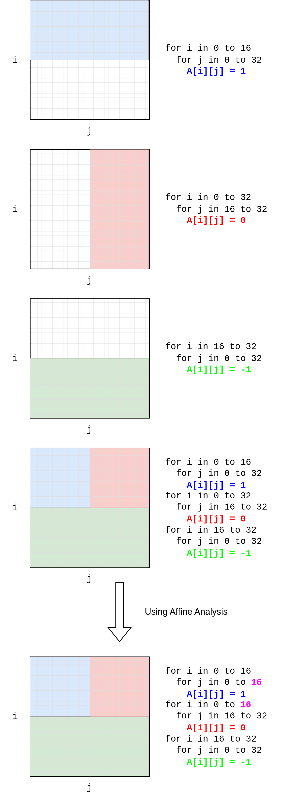
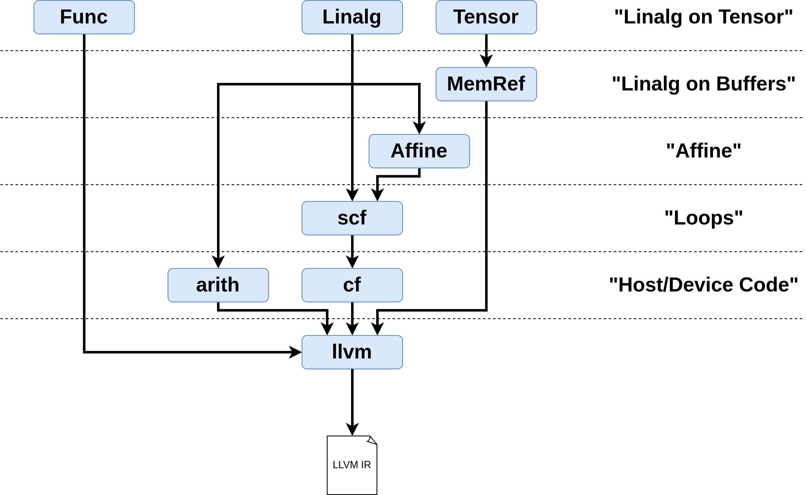

# Chapter 5: Optimizing with the Affine Dialect

> Adapted from [mlir-beginner-friendly-tutorial](https://github.com/AlexandreSinger/mlir-beginner-friendly-tutorial) by Alexandre Singer (MIT).

## What you will learn

- What affine analysis is: modeling memory access patterns as polyhedra so the
  compiler can *prove* facts about loops and buffers.
- What makes a loop, load, or store "affine" — and what does not.
- How to take a pit stop in the `affine` dialect while lowering from `linalg`
  to `scf`, using `--convert-linalg-to-affine-loops`.
- How `--affine-loop-fusion` fuses three loop nests into one and eliminates a
  1 MB intermediate buffer along the way.
- How `--affine-loop-tile="cache-size=..."` tiles loops for cache locality.
- How to lower back out of the affine dialect with `--lower-affine`, and how
  the result compares to the unoptimized pipeline from Chapter 2.

## Prerequisites

- Chapter 1: you can read linalg-on-tensor IR and know the matmul + ReLU
  kernel we have been carrying through this tutorial.
- Chapter 2: you know how `mlir-opt` chains passes, what bufferization does,
  and how the kernel lowers through `scf` down to LLVM IR.
- A working `mlir-opt` on your `PATH` (see the root README for setting up the
  MLIR wheel and activating the virtual environment).

## Why optimize at a high level?

MLIR can do much more than just lower high-level code to CPUs and other
targets. What makes MLIR so powerful is its ability to do high-level analysis
and optimization *as it is lowering*. One analysis built into MLIR's core
dialects is **affine analysis**.

In a nutshell, affine analysis uses analytical models to represent how code
accesses buffers. By using these models, the compiler can deduce the memory
access patterns of buffers, which enables exciting optimizations like
**fusing complicated loops together** and **tiling loops** to improve cache
locality.

The figure below demonstrates the core idea. Affine analysis lets us describe
a memory access pattern as a polyhedron in memory space. The first example is
a loop nest that sets the first 16x32 elements of a 32x32 2D array to 1;
affine analysis tells us the access pattern is a 16x32 rectangle starting at
(0, 0), shown in blue. The red and green rectangles describe two other loop
nests the same way.

Things get interesting when the three loop nests are combined into one
kernel. The kernel does extra work: later writes overlap earlier ones. Affine
analysis recognizes this by simply computing the overlap of the rectangles.
Seeing that the blue rectangle is overlapped by the red and green ones, we
can shrink the bound of `j` from 32 to 16; similarly the red rectangle's `i`
bound can shrink to 16 to avoid writing locations the green rectangle will
overwrite anyway.

<div align="center">
  
  <br><b>Figure 1:</b> Affine analysis introduction
</div>

This was a simple example, but the same machinery supports much more
interesting optimizations. For instance, computing the *area* of these
polyhedrons tells us exactly how many elements a loop nest touches — its
memory footprint — and the compiler can then transform loops to keep that
footprint small within certain loop iterations. That is precisely what the
tiling pass at the end of this chapter does.

### What is (and is not) affine

Affine analysis is powerful, but it has strict preconditions:

- **Loops**: the lower and upper bounds must be affine functions (i.e.
  **linear combinations of variables** plus a constant), and the step must be
  a fixed constant.
- **Loads/stores**: the address must be computed by an affine function of the
  enclosing loop induction variables and symbols. `A[2*i][j + 32]` is affine;
  `A[0][i*j]` is not (it multiplies two variables).
- **If statements** have analogous restrictions on their conditions.

The [`affine` dialect](https://mlir.llvm.org/docs/Dialects/Affine/) packages
these guarantees into the IR itself: an `affine.for`, `affine.load`, or
`affine.store` *cannot express* a non-affine loop or access. This sits at a
level of abstraction below `linalg` but above plain `scf` loops. Because the
guarantees are structural, the analysis does not need to re-prove them — it
can immediately reason about access patterns.

### The pit stop

The lowering strategy is: as we lower from `linalg` toward `scf`, we make a
pit stop in the `affine` dialect, perform optimizations there, and then
continue down to `scf`. This is a classic MLIR approach because each
direction is easy in exactly one way: it is straightforward to turn `linalg`
ops into affine loops/loads/stores, and easy to lower any affine op into
`scf` + `memref` — but it is *hard* to raise an arbitrary `scf` loop or
`memref` access back into the affine dialect.

<div align="center">
  
  <br><b>Figure 2:</b> Lowering through the affine dialect
</div>

## Running the pipeline

Everything in this chapter is driven by [`examples/optimize.sh`](examples/optimize.sh),
which starts from the same linalg-on-tensor kernel used in Chapters 1 and 2
([`examples/0-linalg-on-tensor.mlir`](examples/0-linalg-on-tensor.mlir): a
256x512 x 512x1024 matmul followed by a ReLU — the Chapter 1 file
round-tripped through `mlir-opt` to strip the comments) and produces one
`.mlir` file per stage:

```bash
cd part1-using-mlir/ch05-affine-optimization/examples
./optimize.sh
```

| Stage | File | Passes |
|-------|------|--------|
| 0 | `0-linalg-on-tensor.mlir` | (input) |
| 1 | `1-linalg-on-memref.mlir` | `--one-shot-bufferize="bufferize-function-boundaries=true"` |
| 2 | `2-affine.mlir` | `--convert-linalg-to-affine-loops` |
| 3 | `3-affine-fused.mlir` | `--affine-loop-fusion` |
| 4 | `4-affine-fused-tiled.mlir` | `--affine-loop-tile="cache-size=1024"` + cleanup |
| 5 | `5-loops.mlir` | `--lower-affine --canonicalize` |
| 6 | `6-loops-unoptimized.mlir` | `--convert-linalg-to-loops` (Chapter 2 path, for comparison) |

All IR listings below are the actual outputs of running this script with the
current MLIR wheel (LLVM 24).

## Step 1: Into the affine dialect

First we bufferize, exactly as in Chapter 2 — affine analysis reasons about
*buffers*, so we need to be on memrefs. Then, instead of
`--convert-linalg-to-loops`, we use `--convert-linalg-to-affine-loops`:

```bash
mlir-opt 0-linalg-on-tensor.mlir \
    --one-shot-bufferize="bufferize-function-boundaries=true" \
    -o 1-linalg-on-memref.mlir

mlir-opt 1-linalg-on-memref.mlir \
    --convert-linalg-to-affine-loops \
    -o 2-affine.mlir
```

This produces:

```mlir
module {
  func.func @main() -> memref<256x1024xf32> {
    %cst = arith.constant 0.000000e+00 : f32
    %alloc = memref.alloc() {alignment = 64 : i64} : memref<256x512xf32>
    %alloc_0 = memref.alloc() {alignment = 64 : i64} : memref<512x1024xf32>
    %alloc_1 = memref.alloc() {alignment = 64 : i64} : memref<256x1024xf32>
    affine.for %arg0 = 0 to 256 {
      affine.for %arg1 = 0 to 1024 {
        affine.store %cst, %alloc_1[%arg0, %arg1] : memref<256x1024xf32>
      }
    }
    affine.for %arg0 = 0 to 256 {
      affine.for %arg1 = 0 to 1024 {
        affine.for %arg2 = 0 to 512 {
          %0 = affine.load %alloc[%arg0, %arg2] : memref<256x512xf32>
          %1 = affine.load %alloc_0[%arg2, %arg1] : memref<512x1024xf32>
          %2 = affine.load %alloc_1[%arg0, %arg1] : memref<256x1024xf32>
          %3 = arith.mulf %0, %1 : f32
          %4 = arith.addf %2, %3 : f32
          affine.store %4, %alloc_1[%arg0, %arg1] : memref<256x1024xf32>
        }
      }
    }
    %alloc_2 = memref.alloc() {alignment = 64 : i64} : memref<256x1024xf32>
    affine.for %arg0 = 0 to 256 {
      affine.for %arg1 = 0 to 1024 {
        %0 = affine.load %alloc_1[%arg0, %arg1] : memref<256x1024xf32>
        %1 = arith.cmpf ugt, %0, %cst : f32
        %2 = arith.select %1, %0, %cst : f32
        affine.store %2, %alloc_2[%arg0, %arg1] : memref<256x1024xf32>
      }
    }
    return %alloc_2 : memref<256x1024xf32>
  }
}
```

This looks very similar to the scf-on-memref level of abstraction from
Chapter 2 — three separate loop nests: zero-fill the accumulator, compute the
matmul, apply ReLU into a *second* 256x1024 buffer. The crucial difference is
that **this dialect comes with guarantees on how memrefs are accessed within
the kernel**: every bound is a constant, every subscript is an affine
function of the induction variables. That is what makes the next two passes
possible.

## Step 2: Affine loop fusion

The original kernel separates the zeroing of the output buffer, the matmul,
and the ReLU into three loop nests. We can see the memory accesses between
these loops line up, but without affine analysis the compiler struggles to
prove it — at the `scf` level it cannot be certain the loops are independent.
The `--affine-loop-fusion` pass can:

```bash
mlir-opt 2-affine.mlir --affine-loop-fusion -o 3-affine-fused.mlir
```

```mlir
module {
  func.func @main() -> memref<256x1024xf32> {
    %alloc = memref.alloc() : memref<1x1xf32>
    %cst = arith.constant 0.000000e+00 : f32
    %alloc_0 = memref.alloc() {alignment = 64 : i64} : memref<256x512xf32>
    %alloc_1 = memref.alloc() {alignment = 64 : i64} : memref<512x1024xf32>
    %alloc_2 = memref.alloc() {alignment = 64 : i64} : memref<256x1024xf32>
    affine.for %arg0 = 0 to 256 {
      affine.for %arg1 = 0 to 1024 {
        affine.store %cst, %alloc[0, 0] : memref<1x1xf32>
        affine.for %arg2 = 0 to 512 {
          %3 = affine.load %alloc_0[%arg0, %arg2] : memref<256x512xf32>
          %4 = affine.load %alloc_1[%arg2, %arg1] : memref<512x1024xf32>
          %5 = affine.load %alloc[0, 0] : memref<1x1xf32>
          %6 = arith.mulf %3, %4 : f32
          %7 = arith.addf %5, %6 : f32
          affine.store %7, %alloc[0, 0] : memref<1x1xf32>
        }
        %0 = affine.load %alloc[0, 0] : memref<1x1xf32>
        %1 = arith.cmpf ugt, %0, %cst : f32
        %2 = arith.select %1, %0, %cst : f32
        affine.store %2, %alloc_2[%arg0, %arg1] : memref<256x1024xf32>
      }
    }
    return %alloc_2 : memref<256x1024xf32>
  }
}
```

The compiler recognized that **all three loop nests could be fused into
one**. This has two big effects:

1. **One traversal instead of three.** We no longer iterate over 256x1024
   elements three separate times; each output element is zeroed, accumulated,
   and ReLU'd in a single pass.
2. **A 1 MB buffer disappeared.** In stage 2 the matmul accumulated into a
   full 256x1024 buffer that the ReLU then read from. After fusion, each
   accumulated value is consumed immediately, so affine analysis shrinks that
   intermediate to a single-element `memref<1x1xf32>` scratch cell. Only the
   final output buffer remains at full size. Beyond saving memory, this
   dramatically reduces the working set of the kernel, which helps cache
   locality.

## Step 3: Tiling for the cache

Speaking of cache locality, we can further improve our cache hit rate with
tiling. Tiling is a target-specific optimization: it needs to know the cache
size and the memory footprint of the loop nests. Affine analysis can compute
the footprint (the polyhedron areas from Figure 1), and we supply the cache
size — here 1024 KiB, a typical L2 size:

```bash
mlir-opt 3-affine-fused.mlir \
    --affine-loop-tile="cache-size=1024" \
    --affine-loop-normalize \
    --canonicalize \
    -o 4-affine-fused-tiled.mlir
```

The raw tiling output uses odd-looking induction variables and bounds, so the
script runs `--affine-loop-normalize` and `--canonicalize` afterwards purely
to make the IR readable:

```mlir
module {
  func.func @main() -> memref<256x1024xf32> {
    %cst = arith.constant 0.000000e+00 : f32
    %alloc = memref.alloc() : memref<1x1xf32>
    %alloc_0 = memref.alloc() {alignment = 64 : i64} : memref<256x512xf32>
    %alloc_1 = memref.alloc() {alignment = 64 : i64} : memref<512x1024xf32>
    %alloc_2 = memref.alloc() {alignment = 64 : i64} : memref<256x1024xf32>
    affine.for %arg0 = 0 to 128 {
      affine.for %arg1 = 0 to 512 {
        affine.for %arg2 = 0 to 2 {
          affine.for %arg3 = 0 to 2 {
            affine.store %cst, %alloc[0, 0] : memref<1x1xf32>
            affine.for %arg4 = 0 to 512 {
              %3 = affine.load %alloc_0[%arg2 + %arg0 * 2, %arg4] : memref<256x512xf32>
              %4 = affine.load %alloc_1[%arg4, %arg3 + %arg1 * 2] : memref<512x1024xf32>
              %5 = affine.load %alloc[0, 0] : memref<1x1xf32>
              %6 = arith.mulf %3, %4 : f32
              %7 = arith.addf %5, %6 : f32
              affine.store %7, %alloc[0, 0] : memref<1x1xf32>
            }
            %0 = affine.load %alloc[0, 0] : memref<1x1xf32>
            %1 = arith.cmpf ugt, %0, %cst : f32
            %2 = arith.select %1, %0, %cst : f32
            affine.store %2, %alloc_2[%arg2 + %arg0 * 2, %arg3 + %arg1 * 2] : memref<256x1024xf32>
          }
        }
      }
    }
    return %alloc_2 : memref<256x1024xf32>
  }
}
```

The pass tiled the two outermost loops by 2x2: the outer pair (`0 to 128`,
`0 to 512`) walks over tiles, and the inner pair (`0 to 2`, `0 to 2`)
computes a 2x2 block of output elements per tile. Note the subscripts like
`%arg2 + %arg0 * 2` — affine maps expressing the tiled index, still fully
analyzable. This partitioning keeps the data touched by the inner loops small
enough to stay resident in the cache we described.

## Step 4: Back down to SCF

Once we have performed all the affine optimizations we care about, we lower
out of the affine dialect into the `scf` and `memref` dialects with
`--lower-affine`:

```bash
mlir-opt 4-affine-fused-tiled.mlir --lower-affine --canonicalize -o 5-loops.mlir
```

```mlir
module {
  func.func @main() -> memref<256x1024xf32> {
    %c2 = arith.constant 2 : index
    %c512 = arith.constant 512 : index
    %c1 = arith.constant 1 : index
    %c128 = arith.constant 128 : index
    %c0 = arith.constant 0 : index
    %cst = arith.constant 0.000000e+00 : f32
    %alloc = memref.alloc() : memref<1x1xf32>
    %alloc_0 = memref.alloc() {alignment = 64 : i64} : memref<256x512xf32>
    %alloc_1 = memref.alloc() {alignment = 64 : i64} : memref<512x1024xf32>
    %alloc_2 = memref.alloc() {alignment = 64 : i64} : memref<256x1024xf32>
    scf.for %arg0 = %c0 to %c128 step %c1 {
      scf.for %arg1 = %c0 to %c512 step %c1 {
        scf.for %arg2 = %c0 to %c2 step %c1 {
          scf.for %arg3 = %c0 to %c2 step %c1 {
            memref.store %cst, %alloc[%c0, %c0] : memref<1x1xf32>
            scf.for %arg4 = %c0 to %c512 step %c1 {
              %7 = arith.muli %arg0, %c2 overflow<nsw> : index
              %8 = arith.addi %arg2, %7 : index
              %9 = memref.load %alloc_0[%8, %arg4] : memref<256x512xf32>
              %10 = arith.muli %arg1, %c2 overflow<nsw> : index
              %11 = arith.addi %arg3, %10 : index
              %12 = memref.load %alloc_1[%arg4, %11] : memref<512x1024xf32>
              %13 = memref.load %alloc[%c0, %c0] : memref<1x1xf32>
              %14 = arith.mulf %9, %12 : f32
              %15 = arith.addf %13, %14 : f32
              memref.store %15, %alloc[%c0, %c0] : memref<1x1xf32>
            }
            %0 = memref.load %alloc[%c0, %c0] : memref<1x1xf32>
            %1 = arith.cmpf ugt, %0, %cst : f32
            %2 = arith.select %1, %0, %cst : f32
            %3 = arith.muli %arg0, %c2 overflow<nsw> : index
            %4 = arith.addi %arg2, %3 : index
            %5 = arith.muli %arg1, %c2 overflow<nsw> : index
            %6 = arith.addi %arg3, %5 : index
            memref.store %2, %alloc_2[%4, %6] : memref<256x1024xf32>
          }
        }
      }
    }
    return %alloc_2 : memref<256x1024xf32>
  }
}
```

The affine loops became ordinary `scf.for` loops, and the affine subscript
maps became explicit `arith.muli`/`arith.addi` index arithmetic. The affine
guarantees are gone — but we no longer need them.

## Comparison: with and without the pit stop

Compare that to the same kernel lowered directly to `scf` without the affine
detour (`6-loops-unoptimized.mlir`, the Chapter 2 result):

```mlir
module {
  func.func @main() -> memref<256x1024xf32> {
    %c512 = arith.constant 512 : index
    %c1024 = arith.constant 1024 : index
    %c1 = arith.constant 1 : index
    %c256 = arith.constant 256 : index
    %c0 = arith.constant 0 : index
    %cst = arith.constant 0.000000e+00 : f32
    %alloc = memref.alloc() {alignment = 64 : i64} : memref<256x512xf32>
    %alloc_0 = memref.alloc() {alignment = 64 : i64} : memref<512x1024xf32>
    %alloc_1 = memref.alloc() {alignment = 64 : i64} : memref<256x1024xf32>
    scf.for %arg0 = %c0 to %c256 step %c1 {
      scf.for %arg1 = %c0 to %c1024 step %c1 {
        memref.store %cst, %alloc_1[%arg0, %arg1] : memref<256x1024xf32>
      }
    }
    scf.for %arg0 = %c0 to %c256 step %c1 {
      scf.for %arg1 = %c0 to %c1024 step %c1 {
        scf.for %arg2 = %c0 to %c512 step %c1 {
          %0 = memref.load %alloc[%arg0, %arg2] : memref<256x512xf32>
          %1 = memref.load %alloc_0[%arg2, %arg1] : memref<512x1024xf32>
          %2 = memref.load %alloc_1[%arg0, %arg1] : memref<256x1024xf32>
          %3 = arith.mulf %0, %1 : f32
          %4 = arith.addf %2, %3 : f32
          memref.store %4, %alloc_1[%arg0, %arg1] : memref<256x1024xf32>
        }
      }
    }
    %alloc_2 = memref.alloc() {alignment = 64 : i64} : memref<256x1024xf32>
    scf.for %arg0 = %c0 to %c256 step %c1 {
      scf.for %arg1 = %c0 to %c1024 step %c1 {
        %0 = memref.load %alloc_1[%arg0, %arg1] : memref<256x1024xf32>
        %1 = arith.cmpf ugt, %0, %cst : f32
        %2 = arith.select %1, %0, %cst : f32
        memref.store %2, %alloc_2[%arg0, %arg1] : memref<256x1024xf32>
      }
    }
    return %alloc_2 : memref<256x1024xf32>
  }
}
```

The optimized kernel is a single fused, tiled loop nest with one full-size
intermediate buffer fewer (a 1x1 scratch cell instead of 1 MB), while the
direct lowering keeps three separate traversals and two full 256x1024
buffers. All of this came essentially for free — from analysis that was only
possible because we stayed at a higher level of abstraction a little longer.

From here, `5-loops.mlir` lowers to LLVM IR exactly as in Chapter 2
(`scf` → `cf` → `llvm` → `mlir-translate`).

## Notes on reproducing with current MLIR

The original tutorial was written against an LLVM/MLIR build from March 2025.
Rerunning the pipeline with the current MLIR wheel (LLVM 24.0.0):

- All pass names and options are unchanged: `--one-shot-bufferize`,
  `--convert-linalg-to-affine-loops`, `--affine-loop-fusion`,
  `--affine-loop-tile="cache-size=..."`, `--affine-loop-normalize`, and
  `--lower-affine` all still exist with the same spelling.
- The headline behavior still holds: `--affine-loop-fusion` **still fuses all
  three loop nests into one** and **still shrinks the 1 MB intermediate
  buffer to `memref<1x1xf32>`**, and tiling still picks 2x2 tiles for
  `cache-size=1024`. The fused (stage 3) and final scf (stage 5) outputs are
  byte-for-byte identical to the 2025 outputs.
- The only visible difference is cosmetic, in the bufferized stage 1:
  `linalg.map` now prints its unused block argument explicitly:

  ```mlir
  (%init: f32) { ... }   // now
  () { ... }             // 2025
  ```

  Bufferization also leaves behind a dead `memref.cast` before the
  `return`, as it did in 2025; a `--canonicalize` would clean it up.

## Where to go next

- **[Chapter 6: Affine Maps and Loop Transformations](../ch06-affine-maps-and-loop-transforms/README.md)**
  — the next chapter writes affine loops by hand, takes affine maps apart,
  and runs the rest of the affine pass catalog (LICM, unrolling,
  scalar replacement, coalescing, vectorization, interchange, skewing).
- **[Chapter 9: Testing with lit and FileCheck](../ch09-testing-with-lit/README.md)**
  — once our pipelines produce interesting IR, it shows how MLIR projects
  write regression tests for passes like the ones we just ran.
- **Teaser:** the fusion and tiling passes in this chapter are classic,
  whole-module "hammer" passes — you set a flag and hope the heuristics fire.
  Modern MLIR also offers a surgical alternative: the **transform dialect**,
  where you script *which* loops get tiled and fused, with what sizes, in IR
  itself. Part 5, Chapter 22 revisits tiling and fusion that way.
